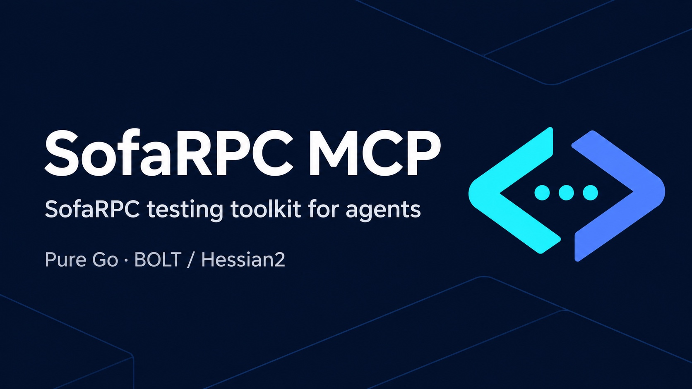

# SofaRPC MCP

[English](README.md) | [简体中文](README.zh-CN.md)



MCP-first SofaRPC testing toolkit for agents.

A single binary `sofarpc` does everything: setup/diagnostic commands (`sofarpc ping`, `sofarpc project`, `sofarpc server`, ...) and the stdio MCP server (`sofarpc mcp`, which is what hosts launch). Invocation runs through a pure-Go direct BOLT/Hessian2 runtime; no Java process or sidecar is required. All invocation is exposed as the `sofarpc_invoke` MCP tool, not a CLI command.

[Architecture overview](docs/readme-hero.svg)

## What Gets Installed

```text
~/.sofarpc/                 (override with SOFARPC_HOME)
  bin/
    sofarpc
  config.json
  cache/
    schema/
```

Installation and upgrades do not overwrite `config.json` or the schema cache;
they only replace the binary at the same canonical path. The runtime may
refresh or remove stale schema-cache entries as source indexes are used.

## Install

Recommended — one line, install and register with your host(s):

```bash
# macOS / Linux
curl -fsSL https://raw.githubusercontent.com/diandian921/sofarpc-mcp/main/scripts/install.sh | bash -s -- codex     # or claude / all
```

```powershell
# Windows
& ([scriptblock]::Create((iwr -useb https://raw.githubusercontent.com/diandian921/sofarpc-mcp/main/scripts/install.ps1))) codex
```

Pin a release with `--version vX.Y.Z` (`-Version vX.Y.Z` in PowerShell).
Without a host argument, the bootstrap installs the binary only and prints
the next step. By default, it follows GitHub's `releases/latest` redirect to
the latest stable release. To install the first prerelease with stateless
MCP support, pin `v0.1.2-beta.3`. The Go install alternative uses an explicit
release tag.

<details>
<summary>Alternative: with Go</summary>

```bash
go install github.com/diandian921/sofarpc-mcp/cmd/sofarpc@vX.Y.Z
# call the just-installed binary by absolute path (GOBIN, else GOPATH/bin):
BIN="$(go env GOBIN)"; BIN="${BIN:-$(go env GOPATH)/bin}"
"$BIN/sofarpc" install codex     # or claude / all
```
</details>

<details>
<summary>Alternative: manual release archive (offline)</summary>

```bash
tar -xzf sofarpc-vX.Y.Z-darwin-arm64.tar.gz
cd sofarpc-vX.Y.Z-darwin-arm64
./sofarpc install codex      # or claude / all
```

```powershell
Expand-Archive -Path sofarpc-vX.Y.Z-windows-amd64.zip -DestinationPath .
cd sofarpc-vX.Y.Z-windows-amd64
.\sofarpc.exe install codex
```
</details>

`sofarpc install <host>` installs the binary, runs `sofarpc mcp --selftest`,
and registers the server with the host CLI. To upgrade an existing installation,
run the installer for the desired version and omit the host argument. For the
commands below, add the installed `bin` directory to `PATH` or use the binary's
absolute path.

Build release archives for the full platform matrix:

```bash
./scripts/package.sh
```

Each archive contains the platform `sofarpc` binary, `README.md`, and
`README.zh-CN.md`. The shared cover and both architecture diagrams are in
`docs/`. A single `SHA256SUMS` file covers all archives. Building from source
requires Go 1.25+ (the MCP layer uses the official `modelcontextprotocol/go-sdk`).

## MCP Configuration

Do not hand-write host config. Register with the host's own CLI via:

```bash
sofarpc setup claude          # or: codex, or: all
sofarpc setup all --dry-run   # preview the exact commands, mutate nothing
```

`setup` registers `command = <root>/bin/sofarpc, args = ["mcp"]` (fully
expanded absolute path, never `~`), propagates `SOFARPC_HOME` only when it
is non-default, and verifies the binary with `sofarpc mcp --selftest` before
touching host config. With Codex, `setup` reads `mcp get --json` and skips
registration when the command matches, the arguments contain `mcp`, and any
requested `SOFARPC_HOME` matches. Replacing a differing Codex entry or any
existing Claude entry requires `--force`.

## MCP Tools

The MCP surface is intentionally small and workflow-oriented:

- `sofarpc_config_list`: list configured projects and servers from `~/.sofarpc/config.json`.
- `sofarpc_config_save_project` / `sofarpc_config_save_server`: add or replace a project/server.
- `sofarpc_config_remove_project` / `sofarpc_config_remove_server`: remove a project/server (requires `confirm=true`).
- `sofarpc_resolve`: resolve the project, server, and endpoint without touching the network.
- `sofarpc_probe`: probe TCP reachability for a configured server or explicit address.
- `sofarpc_describe`: search local Java source or describe a service/method schema.
- `sofarpc_invoke_plan`: resolve and validate an invocation (endpoint, argument types) without sending a request.
- `sofarpc_invoke`: invoke a method over direct BOLT/Hessian2.
- `sofarpc_doctor`: run structured diagnostics for config, source schema, and invoke prerequisites.

The four config-write tools are not registered when the server is started with `--disable-config-write`.

`sofarpc_probe` checks TCP reachability at a configured server address or an explicitly supplied address. A successful probe establishes only TCP reachability.

`sofarpc_invoke` supports either exact low-level arguments:

```json
{
  "server": "user-test",
  "service": "com.example.UserService",
  "method": "getUser",
  "paramTypes": ["java.lang.String"],
  "orderedArguments": ["u001"],
  "attachments": {
    "traceId": "trace-001"
  }
}
```

or named arguments when local source can resolve the method signature:

```json
{
  "server": "user-test",
  "service": "com.example.UserService",
  "method": "getUser",
  "arguments": {
    "userId": "u001"
  }
}
```

Use `sofarpc_invoke_plan` to inspect the resolved endpoint, Java parameter
types, typed ordered arguments, and planning warnings without sending a
SofaRPC request. It does not emit wire-level BOLT/Hessian2 bytes.

Set `rawResult=true` when debugging serialization or response shape problems. The response then includes both the normal flattened `result` and the decoded Java object shape as `rawResult`.

## Config File

`~/.sofarpc/config.json` is stable and user-editable. The current schema version
is `2`. Older v1 files without `version` are still read as version 1; unsupported
future versions are rejected with `CONFIG_UNSUPPORTED_VERSION`.

```json
{
  "version": 2,
  "defaults": {
    "protocol": "bolt",
    "timeoutMs": 5000,
    "appName": "sofarpc-agent",
    "attachments": {}
  },
  "projects": {
    "user": {
      "activeProfile": "test",
      "workspaceRoot": "/Users/me/workspace/user-service",
      "servicePrefixes": ["com.company.user."],
      "profiles": {
        "local": {
          "address": "127.0.0.1:12200"
        },
        "test": {
          "address": "10.0.0.1:12200"
        }
      }
    }
  }
}
```

Profiles are project-scoped, Spring-style endpoint selections. Calls may pass
`project` + `profile`; when `profile` is omitted the project's `activeProfile`
is used. The legacy flat `servers` view is still available in memory, derived as
`<project>-<profile>` (for example `user-test`), so existing `server` arguments
continue to work.

Configured `attachments` are default SOFARPC request baggage (`rpc_req_baggage`).
Per-call `sofarpc_invoke` / `sofarpc_invoke_plan` `attachments` are merged on top
and override configured defaults. Provider code can read them with
`RpcInvokeContext.getContext().getRequestBaggage(key)`. Treat values stored in
local config as credentials.

## CLI

Use CLI for setup and diagnostics:

```bash
sofarpc project add user /Users/me/workspace/user-service --prefix com.company.user
sofarpc server add user-test 10.0.0.1:12200 --project user --profile test
sofarpc project list
sofarpc project list --json
sofarpc server list
sofarpc server list --json
```

The `ping` command emits the same structured result contract the MCP tools return. Method invocation is not a CLI command — use the `sofarpc_invoke` MCP tool (or `sofarpc_invoke_plan` for a no-network dry run).

## Local Source Schema

The MCP server parses local Java source only. It does not download Git repos, source jars, Maven dependencies, or load project classes.

The scanner discovers `src/main/java` at the workspace root and in nested modules, up to nine directory levels below `workspaceRoot`. If `workspaceRoot` itself points to a `src/main/java` directory, the scanner uses it directly.

Ignored:

- `src/test/java`
- `target`
- `build`
- `.git`
- `.idea`
- `node_modules`

Schema cache is stored under `~/.sofarpc/cache/schema/` and invalidated by source content fingerprint. Entries unused for 7 days may be cleaned.

## Runtime Boundaries

The pure-Go runtime covers direct BOLT generic invocation and the common Hessian2 value shapes used by DTO-style requests and responses. Declared Java argument and DTO field types are used for numeric encoding, so values such as `Integer`, `Long`, and `Double` do not depend on Go's JSON number shape. The current Java compatibility status is available through the read-only `sofarpc://compatibility` resource.

Known limits:

- object reference preservation is not implemented for request encoding; cyclic request values are rejected.
- `java.util.Date` request values must be epoch millis numbers; date/time strings are rejected during planning to avoid timezone ambiguity.
- Go request encoding for enum payloads without source schema and provider-specific Hessian extensions needs more compatibility work before relying on them broadly. Schema-known enum parameters and DTO fields are covered by Hessian oracle tests.
- Hessian2 map keys become strings during decoding, so both `result` and `rawResult` use string keys. Keys that stringify to the same value can collide.

## Security Boundaries

`sofarpc mcp` is a local developer tool. Treat stdout as the JSON-RPC protocol stream; diagnostics and future logging must go to stderr. `sofarpc_probe` can dial an explicit address for diagnostics, so prefer configured servers when running against untrusted agent input.

The JSON-RPC protocol layer is the official `modelcontextprotocol/go-sdk` (stdio transport, lifecycle, framing, cancellation). On a handler panic the client receives only a fixed `internal error` message plus an `errorId`; the detail and stack go to stderr under that id.

## MCP Compliance

`sofarpc mcp` supports both MCP lifecycles over stdio. The stateless lifecycle is available starting with `v0.1.2-beta.3`.

**Stateless MCP (`2026-07-28`).** Start `sofarpc mcp` and send each JSON-RPC message as a newline-terminated line on stdin. Skip `initialize` and `notifications/initialized`. Each request must carry `io.modelcontextprotocol/protocolVersion` and `io.modelcontextprotocol/clientCapabilities` in `params._meta`. Use `{}` for client capabilities if you have none to declare. You can also include `io.modelcontextprotocol/clientInfo` to identify your client.

Call `server/discover` with the same metadata to query supported versions and server capabilities. If you already know the server supports `2026-07-28`, you can send `tools/list` as the first request. [MCP discovery specification](https://modelcontextprotocol.io/specification/2026-07-28/server/discover)

```json
{"jsonrpc":"2.0","id":1,"method":"tools/list","params":{"_meta":{"io.modelcontextprotocol/protocolVersion":"2026-07-28","io.modelcontextprotocol/clientCapabilities":{}}}}
```

**Legacy MCP (`2025-11-25` and earlier).** The server still accepts `2025-11-25`, `2025-06-18`, `2025-03-26`, and `2024-11-05` via the legacy handshake. Send `initialize` with the requested protocol version, wait for the response, then send `notifications/initialized` before calling tools. For an unsupported version requested through `initialize`, the server returns `2025-11-25` in the response.

If the first request is `tools/list` without the stateless metadata, the current Go SDK rejects it with JSON-RPC `error.code` set to `0` and the message `method "tools/list" is invalid during session initialization`.

Declared capabilities include `tools` (static list), `prompts`, and `resources`. Diagnostics go to stderr. The SDK propagates `notifications/cancelled` to the request handler's context. `sofarpc_invoke`, `sofarpc_doctor`, and `sofarpc_describe` emit `notifications/progress` when the client supplies `params._meta.progressToken`. Use a JSON string or integer for the token.

Every tool declares a per-tool `outputSchema` that describes the shape of its own `data` (not just the shared envelope). Small results are mirrored as the same JSON in a `text` content block; for results larger than 32 KiB, the full envelope remains in `structuredContent` and the text block becomes a pointer. `_meta.elapsedMs` is always present; `_meta.summary` and `requestId` are included when available.

Input and output schemas guide hosts and LLMs. Tool handlers report argument and business validation failures in an `app.Result` envelope (`isError` plus recovery information in `nextTool` / `recovery`). For example, an unknown field in `tools/call` arguments yields an invalid-arguments envelope. Invalid `tools/call` protocol parameters and unknown tool names yield JSON-RPC errors. `sofarpc_invoke` accepts only the advertised `paramTypes` / `orderedArguments` names — the former `types` / `args` aliases were removed.

The `prompts` capability advertises one user-selected workflow, `sofarpc.invoke_workflow` (the host surfaces it as a slash command or template; it is never auto-executed). Given an `intent` (and optional `server`/`project`/`service`/`method`/`serviceQuery`), it renders the recommended resolve → describe → invoke_plan → invoke path with the failure-recovery contract.

The `resources` capability exposes two read-only resources: `sofarpc://compatibility` — the Java/Hessian2 type support matrix as JSON — and `skill://using-sofarpc/SKILL.md`, the bundled agent skill. The config file itself is deliberately not exposed as a resource because it can carry credential-bearing attachments.

The server also declares the MCP Skills extension (`io.modelcontextprotocol/skills`) and answers `skills/list` and `skills/get`, so a host that supports the extension loads the `using-sofarpc` skill straight from the server, always matching the running binary (Claude Code lists it as `<server>:using-sofarpc`). For other hosts, copy `skills/using-sofarpc/` from the repository at the tag matching your binary into the host's skills directory. Keeping both copies makes the skill appear twice.

The config-write tools (`sofarpc_config_save_*`) accept `dryRun: true` to validate and preview an entry without writing `config.json`. Attachment values are stored verbatim in the local config (treat them as credentials) and are always redacted in tool/resource output. Start the server with `--disable-config-write` to drop all four config-write tools.

Not supported (intentionally not advertised): `roots`, `sampling`, `elicitation`.

## Troubleshooting

- `CONFIG_INVALID`: fix `~/.sofarpc/config.json`; the tool will not overwrite broken JSON.
- `CONFIG_UNSUPPORTED_VERSION`: the config file was written by a newer unsupported version.
- `CONNECT_FAILED`: check the configured server address and network route.
- `RPC_TIMEOUT`: increase `timeoutMs` or check provider/network latency.
- unresolved external DTO fields: local source parsing cannot see external jar parents. Exact `paramTypes + orderedArguments` remains available.

## Test

The pure-Go suite runs in CI (`.github/workflows/ci.yml`: `gofmt` + `go build` +
`go vet` + `go test -race` + the BOLT oracle) and locally from the repo root:

```bash
go test ./...
```

Some tests open loopback ports. In restricted sandboxes, they need permission to bind `127.0.0.1`.

### Real-compatibility oracle (pre-release gate)

The hand-written Hessian2/BOLT codec is verified against real oracles — a JVM
running the alipay Hessian library, and the official `sofa-bolt-go` library. The
BOLT oracle lives in the `oracletest/` module (own `go.mod`, so the sofa-bolt-go
dependency tree stays out of the main module) and also runs in CI. Run the full
gate before cutting a release:

```bash
bash scripts/oracle-gate.sh
```

It runs both oracles and, crucially, treats a **skipped** oracle as a failure: the
Hessian oracle `t.Skip()`s when the JVM or the alipay Hessian jar (`~/.m2`) is
missing, and a skipped Go test still exits 0 — which would fake a pass. The gate
fails loudly instead, so green always means the codec was actually checked.

The Hessian oracle is excluded from CI (the alipay Hessian jar is an internal
artifact not on public Maven). The underlying commands, if you want to run one
directly:

```bash
go test ./internal/direct -tags hessian_oracle    # Go<->Java Hessian contract + golden bytes == real Java
go -C oracletest test -tags bolt_oracle ./...     # BOLT framing vs official sofa-bolt-go
```
